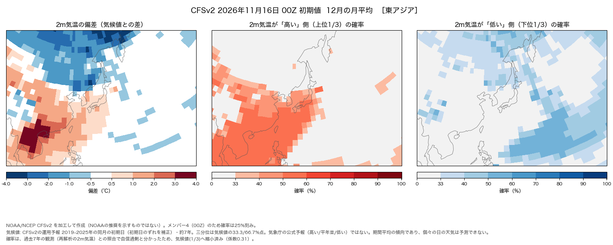
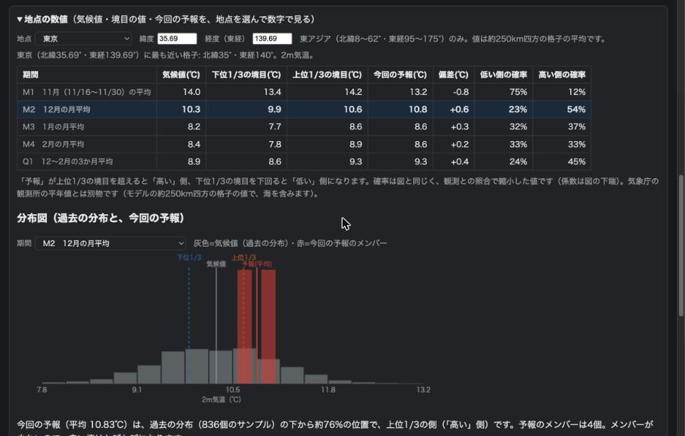

# 長期予報の図 かんたんガイド（初心者向け）

この文書は、**気象の専門知識がなくても**、このサイトの図を読んで使えるようになることを目標にしています。
「図の読み方」「データはどこから来るのか」「数字はどう作っているのか」「毎週の更新はどう動くのか」「どのくらい当たるのか」の順に説明します。
急ぐ人は、**第1章**と**第2章**だけ読めば図を読めます。**画面の操作方法は[操作マニュアル](manual.html)**にまとめてあります。

> **最初に大事なこと**
> - これは**気象庁の公式予報ではありません**。数値モデルの計算結果を、私たちが加工して作った図です。
> - 分かるのは「**1か月や3か月といった期間全体の傾向**」だけです。「来月の○日は雨」のような**個々の日の天気は予測できません**。
> - 防災や仕事の重要な判断には、気象庁の最新の情報を使ってください。

---

## 第1章　長期予報とは何か

### 1-1　天気予報との違い

| | 普通の天気予報（数日先） | 長期予報（1か月〜数か月先） |
|---|---|---|
| 分かること | 明日は雨、気温は20℃、など**日ごとの天気** | **期間全体が平年より暖かいか寒いか、雨が多いか少ないか**の傾向 |
| 当たりやすさ | 高い | **低い**（特に先の期間ほど） |
| 表し方 | 天気マーク・気温 | **確率**（「高い側になる可能性が○％」） |

天気は、ほんの少しの違いが、時間がたつと大きな違いになる性質（カオス）を持っています。
そのため、2週間より先の「日ごとの天気」は、原理的に当てられません。
それでも、海の水温（エルニーニョなど）や大気のゆっくりした変化は、**期間全体の傾向**にある程度の手がかりを与えます。長期予報は、その手がかりを使います。

### 1-2　「平年」と「偏差」

- **平年（このサイトでは「気候値」）**: 過去の同じ時期の平均的な状態。
- **偏差**: 予報が、平年よりどれだけ違うか（予報 − 平年）。**+1.0℃なら「平年より1℃高い」**。

たとえば、12月の東京の平年が8℃で、予報が9℃なら、偏差は +1℃です。
**「気温が9℃」より「平年より1℃高い」の方が、長期予報では意味のある情報**です。

### 1-3　「アンサンブル」と「メンバー」

数値モデルは、**少しずつ違う出発点から、何本も計算**します。この1本1本を**メンバー**、全体を**アンサンブル**と呼びます。

```
出発点A → 計算 → 12月は +1.2℃
出発点B → 計算 → 12月は +0.4℃
出発点C → 計算 → 12月は −0.3℃
出発点D → 計算 → 12月は +0.9℃
         ↓
  4本のうち3本が「平年より高い」 → 「高い側の確率は約75%」
```

メンバーが**ばらける**ほど、予報は自信がないことになります。**確率は、このばらつきから作ります。**

---

## 第2章　図の読み方

### 2-1　1枚の図は「3つの地図」でできている

図は、横に3つの地図が並んでいます。

| 左 | 中 | 右 |
|---|---|---|
| **偏差**（平年との差） | **「高い」側の確率** | **「低い」側の確率** |
| 気温なら、赤=平年より高い、青=低い | 赤が濃いほど、高い側になる確率が大きい | 青が濃いほど、低い側になる確率が大きい |

**まず左の図で全体の傾向を見て、次に中・右の図でその確からしさを見る**、という順番がおすすめです。

**実際の図の例**（2026年11月16日の計算・12月の月平均・東アジアの2m気温）:



この例の読み方:
- **左（偏差）**: 中国南部〜東南アジアは**赤**（平年より高め。濃い赤は+3℃以上）、ロシア極東など北の方は**青**（平年より低め）。**日本付近はほぼ白**＝平年並みに近い。色の濃さが偏差の大きさ（下の色の棒が目盛り）。
- **中（高い側の確率）**: 中国南部〜東シナ海で赤く、確率は40〜50%台。**日本付近はほとんど灰色（33%付近）＝傾向がはっきりしない**。
- **右（低い側の確率）**: 北の方と、日本の南東の海上が青い（低い側になりやすい）。**日本付近は灰色**。
- この例のように、**「日本は傾向がはっきりしない」**というのは、長期予報ではごく普通の結果です。無理に読み取らないでください。
- **一番上のタイトル**: モデル・初期値（計算を始めた日）・対象の期間・領域。**一番下の小さい文字**: 気候値の出どころ、メンバー数（4つだと確率は25%刻み）、確率を控えめにした度合い（係数。この例は0.31）。

### 2-2　確率の読み方（ここがいちばん大事）

このサイトでは、**過去の同じ時期の値を、小さい順に3等分**します。

```
過去の値を小さい順に並べて、3つに分ける
  ┌──────────┬──────────┬──────────┐
  │ 低い（下位1/3）│ 平年並（中央1/3）│ 高い（上位1/3）│
  └──────────┴──────────┴──────────┘
        33%          33%          33%     ← 何も情報が無いときの確率
```

- **33%は「どちらとも言えない」**（中立）です。灰色で表示されます。
- 「高い側の確率 60%」は、「**平年並や低い側より、高い側になる可能性が高めだ**」という意味です。**60%でも、40%は外れます。**
- 中・右の図で**色が付いていない（灰色）場所は、傾向がはっきりしない場所**です。
- 通常は「高い」と「低い」のどちらか片方だけが色づきます。メンバーのばらつきが大きいと、**両方が33%を超える**こともあります（予報が不確かなサインです）。

> **よくある誤解**: 「確率70%＝70%の確率で雨が降る」ではありません。ここでの確率は、「**期間全体が平年より高い側（または低い側）に入る確率**」です。

### 2-3　選べる項目の意味

**変数（何を見るか）**

| 変数 | 意味 | 読み方のコツ |
|---|---|---|
| 2m気温 | 地上付近（高さ2m）の気温 | 偏差が主役。「平年より高い／低い」 |
| 降水量 | 雨や雪の量 | 気温より**当たりにくい**。確率の差は小さく出ることが多い |
| 500hPa高度 | 上空約5500mの気圧の高さ。**偏西風の蛇行**を表す | 高度が高い所=高気圧に覆われやすい。天気の「背景」を見るのに使う |
| 流線関数（850・200hPa）・速度ポテンシャル（200hPa）・OLR | 上空の風の渦・上層の発散収束・雲の多さ（月平均の系列のみ） | **2-8** を参照 |
| 海面付近の水温 | 海の表面近くの水温（5m） | 海は変化がゆっくりで、長期予報の**手がかり**になる |

**期間（どの時期の平均か）**

| 呼び方 | 意味 |
|---|---|
| 週1〜週4（W1〜W4） | 予報開始日から数えた1週目〜4週目の平均（日付が図に書いてある） |
| 28日（J28） | 気象庁の1か月予報と同じ、約4週間の平均 |
| 月1〜月4（M1〜M4）・3か月 | **暦の月**ごとの平均（例: 12月、1月）と、3か月平均。**月1は、計算を始めた日以降の「その月の残り」だけの平均**（部分月） |
| L1〜L6など（CPS4） | CPS4 の月平均（開始月から数えて何か月目か） |

**領域**: 「東アジア」と「全球」を切り替えられます。日本の予想を見たいときは東アジアです。

### 2-4　系列（どのモデルか）の違い

| 系列 | もとのモデル | 特徴 |
|---|---|---|
| CFSv2 週平均（4メンバー） | 米国 NOAA のモデル | 週ごとの平均。メンバーが4つなので、確率は 0%・25%・50%…と**とびとび** |
| CFSv2 週平均（ラグ18メンバー） | 同じ | 少し古い計算も足して18メンバーにしたもの。確率がなめらか |
| CFSv2 月平均 | 同じ | 暦月の平均（12月、1月…） |
| JMA CPS4 | 気象庁のモデル（欧州の Copernicus 経由で入手） | 月平均。メンバーが約155と多い |

**同じ時期を2つのモデルで比べる（画面の「2系列比較」）と、傾向が一致しているかが分かります。** 一致していれば、傾向の信頼度は少し上がります。違っていれば、不確実性が大きいと考えます。

### 2-5　図の下端の文字を読む

図の一番下に、次のような情報が書いてあります（必ず確認してください）。

- どのモデルか・メンバー数・初期値（計算の出発日）
- 「**気候値**」は何年分のデータから作ったか
- 「**係数（縮小係数）**」: 確率をどのくらい控えめにしたか（第5章）
- 「気象庁の公式予報ではない」の注意書き

### 2-6　図を見るときの手順（まとめ）

1. 図の下端で、**どのモデル・いつの初期値か**を確認する。
2. 左の偏差で、**大まかな傾向（暖かい／寒い、多い／少ない）**をつかむ。
3. 中・右の確率で、**その傾向がどのくらい確かか**を見る（33%に近ければ弱い）。
4. 可能なら、**別のモデル・別の初期値**でも同じ傾向か確かめる。
5. **先の期間ほど、傾向は弱いと思って読む**（第6章）。

### 2-7　気候値・地点の数値・分布図を使って読む

図（地図）は全体の傾向をつかむのに向いていますが、「**この地点で、平年と比べてどのくらい違うのか**」は色からは読み取りにくいことがあります。そんなときのための機能が3つあります（操作の手順は[操作マニュアル](manual.html)）。

**① 気候値（平年）の図** — 画面上部の「気候値（平年）」ボタン
- 予報を比べる**基準（平年）そのもの**を地図で見られます。たとえば「12月の気温は、地域ごとにふだんどのくらいか」が分かります。
- 「下位1/3の境目」「上位1/3の境目」の図は、**平年からどれだけ外れると「低い」「高い」に数えられるか**を示します。境目が平年に近い所は、**少しの違いで「高い」「低い」になりやすい**所です。
- 「境目の幅」が大きい所は、年によるばらつきが大きい所です。**予報が当たりにくい所**と考えてください。

**② 地点の数値** — 図の下の折りたたみ
- 東京・那覇などの地点を選ぶと、**気候値・境目の値・今回の予報・偏差・確率**が表で出ます。
- 例（東京付近の12月の月平均気温）:

| 項目 | 値 |
|---|---|
| 気候値（平年） | 10.3℃ |
| 上位1/3の境目 | 10.6℃ |
| 今回の予報 | 10.8℃ |
| 偏差 | +0.6℃ |
| 高い側の確率 | 54% |

予報（10.8℃）が上位1/3の境目（10.6℃）を超えているので「高い」側です。**境目をわずかに超えただけ**なので、確率は54%と控えめです。



**③ 分布図** — 地点の数値の下
- **灰色の棒**は、過去の同じ時期の分布です。**赤い棒**は、今回の予報のメンバーです。
- 赤い棒が、灰色の分布の**右の端（高い側）に寄っているほど**、「高い」側の確率が大きくなります。
- 赤い棒が、灰色の分布の**真ん中あたりに重なっている**ときは、平年並みと区別がつきません。確率が33%に近くなります。
- **「予報の平均が、過去の分布の下から何%の位置か」**を文章でも出します。約67%を超えれば「高い」側、33%を下回れば「低い」側です。

> **注意**: 値は**約250km四方の格子の平均**で、気象庁の観測所の平年値とは別物です。比べるのは、**同じモデルの予報と気候値**どうしです。

### 2-8　流線関数・速度ポテンシャル・OLR の見方（上空の流れと対流）

気温や降水の図は「結果」ですが、**なぜそうなるのか**（上空の風の流れ・雲の多い場所）を見るための図が、変数タブに加わっています（**月平均の系列**だけ。週平均の系列にはありません）。

**① 流線関数（850hPa・200hPa）** — 風の「渦」の配置
- 風の流れを表す量です。**北半球では、正（赤）の所が高気圧性（時計回り）、負（青）の所が低気圧性（反時計回り）の循環**です（南半球は逆）。
- 850hPa は下層（地上に近い）、200hPa は上層（高さ約12km・ジェット気流の高さ）です。
- 図は**東西平均を除いた「波」の成分**です。赤と青が**東西に交互に並ぶ**ときは、ロスビー波（偏西風の蛇行の波）が伝わっているサインです。
- 日本付近が赤（高気圧性）か青（低気圧性）かで、偏西風が北に蛇行するか南に蛇行するかが分かり、**暖冬・寒冬などの背景**が読めます。

**② 速度ポテンシャル（200hPa）** — 上層の風の「広がり・集まり」
- 上層で風が**広がる（発散）所は負（紫）**、**集まる（収束）所は正（橙）**です。
- 上層で発散している所は、下から空気が昇っている＝**対流（積乱雲）が活発**な所です。エルニーニョのときは、赤道の太平洋の中部〜東部で発散し、インドネシア付近で収束する、という**東西の大きな循環の変化**が見えます。

**③ OLR（外向き長波放射）** — 雲の多さ
- 地球から宇宙へ出る赤外線の量です。**値が低い所は、雲頂が高い＝対流が活発（雨が多い）**、高い所は雲が少ない＝対流が不活発です。
- 偏差の図では、**緑（低い）が対流活発、茶（高い）が不活発**です。

**組み合わせて読む**
- **OLR が低い（対流活発）所と、速度ポテンシャルが負（上層発散）の所は、ほぼ重なります。**重なっていれば、予報の信頼度が少し上がります。
- 熱帯の対流の変化（OLR・速度ポテンシャル）が、**ロスビー波として北へ伝わり**、日本付近の流れ（流線関数）を変える、というつながりを見ます。

> **注意**: これらの図の確率は、観測との照合をまだ行っていないため**未補正**（自信過剰の可能性）です。傾向を見る参考として使ってください。値の単位は流線関数・速度ポテンシャルが 10⁶ m²/s、OLR が W/m² です。

---

## 第3章　データはどこから来るのか

### 3-1　全体の流れ

```
[数値モデルの計算結果]  →  [取得]  →  [統計処理]  →  [図]  →  [このサイト]
 NOAA CFSv2（米国）                偏差・確率を作る
 JMA CPS4（日本・欧州経由）        観測と比べて確率を調整
```

### 3-2　予報データ（数値モデルの計算結果）

**① NOAA CFSv2（米国海洋大気庁の気候予報システム）**
- 米国の機関が、**誰でも自由に使える形**で公開しています（Amazon のクラウド上に置かれた公開データ）。登録は不要です。
- 形式は **GRIB2**（気象データ用の圧縮形式）です。1ファイルが大きいので、**必要な変数だけを取り出して**取得します（索引ファイルで位置を調べ、必要な部分だけ読み込みます）。
- 1日に4回（00・06・12・18時UTC）計算され、**月平均と日別**のデータがあります。
- 注意: 昔の再計算（ハインドキャスト）は、この公開場所にはありません。そのため、**気候値は2019〜2025年の運用予報（約7年分）**から作っています。

**② JMA/MRI-CPS4（気象庁の季節予報システム）**
- 気象庁のモデルの結果を、**欧州の Copernicus（C3S）が配布**しています。利用には登録と、ライセンスへの同意が必要です。
- 1993〜2020年の**過去の再計算（ハインドキャスト）が28年分**あるので、**平年の基準がしっかり作れる**のが強みです。
- 日本の気象庁が直接配る有料のデータは使っていません。

### 3-3　「答え合わせ」用の観測データ

予報がどれくらい当たったかを調べるために、**過去の観測に近いデータ**を使います（確率を調整するためです。第5章）。

| データ | 提供元 | 何に使うか |
|---|---|---|
| NCEP/NCAR 再解析 | 米国 NOAA | 気温・500hPa高度・日々の降水の「正解」 |
| GPCP | 米国 NOAA | 月ごとの降水量の「正解」 |
| ERSSTv5 | 米国 NOAA | 海面水温の「正解」 |

> 再解析は「観測データを使ってモデルで作り直した過去の天気」で、**本物の観測そのものではありません**。降水はとくに精度が低めです。

### 3-4　ライセンス（使ってよい条件）

- NOAA のデータ: 自由に使えます。ただし「NOAAが推奨している」と示してはいけません。
- C3S（JMA/MRI-CPS4）: 自由に使え、再配布もできます。ただし**出典を明記**し、**加工した旨を表示**し、**提供元は品質を保証しない・責任を負わない**ことを書きます。
- 図の下端やサイトの下部に、これらの文言を入れています。詳しくは [NOTICE.md](https://github.com/masauehr/long_range_charts/blob/main/NOTICE.md) を見てください。

---

## 第4章　統計値の作り方（偏差と確率）

専門用語を使わずに言うと、**「過去の同じ時期の予報と比べて、今回の予報は珍しいか？」を数えている**だけです。

### 4-1　ステップ1: 平年（気候値）を作る

- **同じモデルが、過去の同じ時期に出した予報**を集めて、平均を取ります（CFSv2 は約7年分、CPS4 は28年分）。
- 「観測の平年」ではなく、**モデル自身の過去の予報**を基準にします。
  理由: モデルには、**クセ（いつも少し暖かく出る、など）**があります。観測の平年と比べると、そのクセが「偏差」に混ざってしまうからです。
  同じモデルどうしで比べれば、**クセは打ち消し合います**。

**この気候値は、画面で見られます。**
- ビューア上部の「**気候値（平年）**」ボタンを押すと、予報の図の代わりに、次の4枚組の図が出ます。
  1. **気候値（平年）**: 過去の同じ時期の平均。たとえば12月の気温の平均が、地図の色で分かります。
  2. **下位1/3の境目**（平年との差）: これより下なら「低い」側になる、という境目。
  3. **上位1/3の境目**（平年との差）: これより上なら「高い」側になる、という境目。
  4. **境目の幅**: 年によるばらつきの大きさの目安。**幅が大きい所ほど、予報が当たりにくい**（平年から外れても珍しくない）。
- 画面の「**地点の数値**」を開くと、東京や那覇などの地点を選んで、**気候値・境目の値・今回の予報・偏差・確率**を表で見られます。
  たとえば「12月の東京付近は、気候値10.3℃・上位1/3の境目10.6℃・予報10.8℃ → 境目を超えているので高い側（確率54%）」のように確認できます。
- **分布図**（「地点の数値」の下）: 選んだ地点について、**灰色の棒＝過去の分布（気候値）**、**赤い棒＝今回の予報のメンバー**を重ねて見られます。青と橙の点線が「下位1/3」「上位1/3」の境目で、赤の太線が予報の平均です。
  「予報が、過去の分布のどのあたりにあるか」が一目で分かり、**確率の意味**（赤い棒のうち、橙の線より右にあるメンバーの割合が「高い側の確率」）を目で確かめられます。
  メンバーが4つのモデル（CFSv2）では、赤い棒はとびとびになります。
- **注意**: ここでの気候値は、**モデルの約250km四方の格子の値**（海を含む）で、気象庁の観測所の平年値とは別物です。比べるのは、**同じモデルの予報と気候値**どうしです。
- 気候値の図は、**最新の初期日だけ**作っています。

### 4-2　ステップ2: 偏差を作る

```
偏差 ＝ 今回の予報（メンバーの平均） − 平年（過去の予報の平均）
```
これが、図の**左の地図**です。

### 4-3　ステップ3: 「高い・低い」の境目を作る

過去の予報（約7年〜28年分、すべてのメンバー）を小さい順に並べ、**ちょうど1/3と2/3の位置の値**を境目にします。

```
低い ← [1/3の値] → 平年並 ← [2/3の値] → 高い
```

### 4-4　ステップ4: 確率を作る

今回の予報の**メンバーのうち、境目より上（または下）に入った割合**が、確率です。
- 4メンバー中3つが「高い」側 → 高い側の確率は75%
- 18メンバー中9つが「高い」側 → 50%

これが、図の**中・右の地図**です。

### 4-5　細かい工夫（読み飛ばしてもかまいません）

- **初期値のずれの補正**: 過去の予報の出発日が、今回とずれている場合は、そのずれによる差を計算で補正します。
- **月ごとに分ける**: 12月の予報には12月ごろの過去の予報だけを使います（季節で性質が違うため）。
- **ラグアンサンブル**: 数日前に出た計算も「仲間」に加えて、メンバーを増やします。ただし古い計算は精度が少し落ちます。

---

## 第5章　確率を「控えめ」にする理由と方法

### 5-1　なぜ控えめにするのか

モデルの確率は、そのままだと**自信過剰**です。過去の予報を観測と答え合わせすると、「80%」と言っていたのに、実際はそこまで当たっていませんでした。

そこで、**答え合わせの結果に基づいて、確率を33%（中立）の方向に引き戻して**表示しています。

### 5-2　どうやって引き戻すか

```
表示する確率 ＝ 33% ＋ α ×（モデルの確率 − 33%）      α は 0〜1
```

| αの値 | 意味 |
|---|---|
| 1 | モデルの確率をそのまま使う |
| 0.5 | 33%からのずれを半分にする（モデルが60%なら、約47%に） |
| 0 | 常に33%（このモデルは当てにならないので、傾向を示さない） |

αは、**過去のデータで「予報と観測がいちばん合う」値**を探して決めています（具体的には、確率の当たり具合を表す Brier スキルが最良になる値）。
**窓（週1・週3・月2…）ごと、領域ごと、変数ごと、月ごと**に違う値を使っています。図の下端に書いてあります。

### 5-3　答え合わせの指標（用語）

| 指標 | 意味 | 目安 |
|---|---|---|
| **ACC**（相関係数） | 予報の偏差の分布が、実際の偏差の分布とどれだけ似ているか | 1に近いほど良い。**0.6以上でかなり良い・0.3前後で弱い・0付近は技能なし** |
| **BSS**（Brier スキル） | 確率予報が、「いつも33%」と答える方法より良いか | **プラスなら33%固定より良い**。マイナスなら33%固定より悪い |

### 5-4　この方法の限界

- CFSv2 は**約7年分しかなく**、答え合わせの件数が少ないので、αにはかなり誤差があります。
- αは**同じデータで決めている**ため、実力より少し良く見える面があります（過学習）。
- 観測の代わりに使う再解析は、**本物の観測ではありません**。

---

## 第6章　どのくらい当たるのか

### 6-1　期間が先になるほど、当たりにくい

東アジアの2m気温での、答え合わせの結果の目安です（月による違いはあります）。

| 窓 | ACCの目安 | αの目安 | 読み方 |
|---|---|---|---|
| CFS 週1（1週目） | 0.6〜0.85 | 0.6〜0.8 | **かなり使える**（週間予報に近い感覚で使える） |
| CFS 週3（3週目） | 0.1〜0.3 | 0.3〜0.5 | **弱い傾向**。参考程度 |
| CFS 28日 | 0.25〜0.5 | 0.45〜0.65 | 弱〜中程度 |
| CFS 月2（2か月目） | 0.1〜0.25 | 0.2〜0.4 | **弱い** |
| CFS 3か月 | ほぼ0〜0.2 | 0〜0.5 | **ほとんど技能なし**（確率は33%に近い） |
| CPS4 L1（開始月） | 0.35〜0.5 | 0.65〜0.85 | 比較的使える |
| CPS4 L2〜L4（2〜4か月目） | 0〜0.3 | 0.3〜0.55 | 弱い |

### 6-2　変数による違い

- **気温 > 降水量**の順に当たりやすいです。降水量の確率は、答え合わせで**33%固定より悪い**ことが多く、補正してもほとんど33%に近くなります。
- 500hPa高度は、1週目は高い値が出ますが、**答え合わせ用の再解析と同じ系統のデータ**なので、**実際より良く見えている可能性**があります。

### 6-3　エルニーニョの年は少し期待できる

強いエルニーニョの年（1997年・2015年）は、予報の当たり具合が大きく上がりました。ただし**該当する年が2つしかない**ため、「そうかもしれない」という段階です。

**エルニーニョとは**: 太平洋の赤道域（東部〜中部）の海面水温が、平年より高い状態が続く現象です（低いと「ラニーニャ」）。日本の暖冬・冷夏など、世界の天候に影響します。
このサイトの「**エルニーニョ監視**」ページで、次のことを見られます。

- **NINO.3 と NINO.3.4**: 監視する海域の海面水温の「平年との差」。**+0.5℃以上が続くとエルニーニョ、−0.5℃以下が続くとラニーニャ**の目安です。NINO.3 は気象庁の指標（基準は前年までの30年平均）、NINO.3.4 は NOAA の従来の ONI 方式（基準は1991〜2020年平均）です。**NOAA は2026年2月から、公式の指標を「RONI」に切り替えました**（NINO.3.4 の偏差から、熱帯全体の平均偏差を引いて、海全体の温暖化の影響を取り除いたもの）。このサイトでは RONI も併記しています。
- **観測の推移**: 最近の2〜3年の変化（棒グラフ）。**これは気象庁の図ではなく、このサイトが NOAA の海面水温データ（ERSSTv5）から計算した図**です。作り方は、①海域（NINO.3・NINO.3.4）の平均水温を月ごとに出す ②基準の平均を引いて偏差にする ③5か月（NINO.3）・3か月（NINO.3.4）で移動平均する、の3ステップです。
- **今後の予測**: 日本の気象庁のモデル（CPS4）の、半年先までの予測。細い線が各メンバー、太線が平均です。
- **強いエルニーニョのときの注意**: 確率が「100%」のように極端に出ることがあります。これは**モデル内のメンバーがそろっている**ことを示すだけで、実際に100%当たる保証ではありません。

> エルニーニョ現象の**公式な判断**は、気象庁の「エルニーニョ監視速報」（毎月10日ごろ発表）を見てください。このサイトの数値は、別のデータ（NOAAの観測）から作っているため、気象庁の公式値と最大0.5℃ほど違うことがあります。

### 6-4　使うときの心得

- **1〜2週目**: ある程度頼れる。
- **3週目以降・2か月目以降**: **「少し偏る可能性がある」程度**に受け止める。確率が33%に近ければ、傾向なしと同じ。
- **複数のモデル・複数の初期値**で同じ傾向なら、信頼度が少し上がる。
- **意思決定には、気象庁の公式の1か月予報・3か月予報**を使い、このサイトは補助の資料にする。

---

## 第7章　直近の予報はどうやって作られるのか

### 7-1　毎週の更新の流れ（CFSv2）

```
毎週金曜 10:00（Macが自動で実行）
   ↓
① 最新の初期日を探す（データが揃った、いちばん新しい日）
   ↓
② 予報データを取得（月平均・日別・数日前の計算）
   ↓
③ 図を作る（月平均・週平均・ラグ18メンバー版）
   ↓
④ 閲覧画面の一覧を更新
   ↓
⑤ 公開サイトを更新（図と画面だけを送る）
```

- **「初期日」**は、モデルが計算を始めた日です（例: 2026年11月16日の計算結果）。図には、この日付が書いてあります。
- 更新は、**NOAA 側の計算が揃ってから**行います。公開サイトの最新の図は、**更新日の数日前の計算**になります。

### 7-2　毎月の更新（CPS4）

毎月15日に、その月の予報（基準日は月初）を取得して、40枚の図を作り、サイトを更新します。

### 7-3　図の「古さ」に注意

長期予報は、**1週間前の計算でも、傾向はあまり変わりません**。ただし、**初期日が新しいほど、最初の1〜2週間の精度は高い**ので、見る前に初期日を確認してください。
画面の **`[` と `]` キー**で、初期日を前後に動かして、**予報が変わったか（傾向が安定しているか）**を確かめられます。

### 7-4　自分のパソコンで動かすとき（上級者向け）

- 動かし方・設定は [long-range-charts.md](https://github.com/masauehr/long_range_charts/blob/main/long-range-charts.md) に書いてあります。
- 校正（確率の調整）は、月ごとに1回ずつ行い、`calibration.json` に保存します。

---

## 第8章　よくある質問

**Q. 気象庁の1か月予報と、どう違いますか？**
A. 気象庁の予報は、公式の予報で、「高い・平年並・低い」の3階級の確率を示します。このサイトは、**海外のモデルの結果を私たちが加工した図**で、基準期間も確率の意味も違います。**同じ数字として比べないでください。**

**Q. 確率が33%付近ばかりで、何も分かりません。**
A. それが正直な結果です。**先の期間は、情報がほとんど無い**ためで、確率を控えめにしてあります。これは図の不具合ではありません。

**Q. 日本の○月は寒くなりますか？**
A. 図の左（偏差）と、右（低い側の確率）を見てください。**色が濃く、確率が40%を大きく超えるときだけ、「そうなりやすい」と読みます。**それでも、外れることがあります。

**Q. 2つのモデルで結果が違います。**
A. 不確実性が大きいということです。**どちらかを信じるのではなく、「はっきりしない」と受け止めます。**

**Q. 「気候値」は、気象庁の平年値と同じですか？**
A. **違います。** このサイトの気候値は、**モデル自身の過去の予報**から作った平均で、約250km四方の格子の値（海を含む）です。気象庁の平年値は、観測所での観測の30年平均です。**予報と比べるときは、同じモデルの気候値**を使う必要があります（モデルのクセが打ち消されるため）。

**Q. 地点の数値で、予報が境目を超えているのに、確率が50%台です。**
A. 確率は、**メンバー全体のうち何割が境目を超えたか**から作ります。平均がわずかに境目を超えているだけだと、メンバーの約半分しか超えません。さらに、確率は控えめにしてあるので、数字は小さくなります。

**Q. エルニーニョ監視の数値が、気象庁の発表と違います。**
A. 気象庁は別の海面水温データ（COBE-SST2）と気象庁の基準を使っています。このサイトは NOAA のデータ（ERSSTv5）から作っているので、**最大0.5℃ほど違う**ことがあります。公式の判断は気象庁の速報を見てください。

**Q. 図の色がカクカクしています。**
A. データの格子（2.5°、約250km前後）が粗いためです。市町村レベルの違いは読めません。

**Q. 雨の予報を見るときの注意は？**
A. 降水量は、気温より当たりにくく、確率はほとんど33%に近くなります。**降水量の図は、目安程度**にしてください。

---

## 第9章　用語集

| 用語 | 意味 |
|---|---|
| 数値モデル | 大気や海を計算で再現するプログラム。スーパーコンピュータで動かす |
| 初期値（初期日） | 計算を始める時点の状態（その日付） |
| 予報時間（リード） | 初期値から何日（何か月）先か |
| アンサンブル／メンバー | 少しずつ違う出発点から、何本も計算すること／その1本 |
| ラグアンサンブル | 数日前の計算も仲間に加えて、メンバーを増やす方法 |
| 気候値（平年） | 過去の同じ時期の平均。ここでは**モデル自身の過去の予報**から作る |
| 偏差 | 予報 − 気候値。平年からの差 |
| 三分位 | 過去の値を3等分した区切り。低い・平年並・高い |
| 確率 | 三分位の「高い」または「低い」に入るメンバーの割合 |
| ハインドキャスト | 過去の日付について、あとから同じモデルで作り直した予報。平年の基準に使う |
| 再解析 | 観測をモデルに取り込んで作った、過去の天気の再現データ。「答え合わせ」に使う |
| ACC | 予報と観測の偏差の相関。1に近いほど良い |
| 流線関数 | 風の流れ（渦）を表す量。北半球では正=高気圧性・負=低気圧性 |
| 速度ポテンシャル | 風の発散・収束を表す量。上層で負=発散（対流活発） |
| OLR | 地球から宇宙へ出る赤外線の量。低い=雲頂が高い=対流活発 |
| ロスビー波 | 偏西風の蛇行の波。赤と青が交互に並ぶ「波列」として現れる |
| BSS | 確率予報が「いつも33%」より良いかを示す指標。プラスなら良い |
| 縮小係数（α） | 確率を33%の方向へ引き戻す度合い（0〜1） |
| 500hPa高度 | 上空約5500mの気圧の高さ。偏西風の蛇行や高気圧・低気圧の配置を見る |
| エルニーニョ／ラニーニャ | 太平洋赤道域の海面水温が平年より高く／低くなる現象。世界の天候に影響する（NINO.3・NINO.3.4 の偏差が ±0.5℃ 以上が目安） |
| ONI / RONI | NOAA のエルニーニョ指標。ONI は NINO.3.4 の3か月移動平均、RONI は ONI から熱帯全体の平均偏差を引いたもの（NOAA は2026年2月から RONI が公式） |
| GRIB2 | 気象データ用の圧縮形式のファイル |
| 初期値のずれ | 過去の予報と今回の予報で、出発日が少し違うこと（補正する） |

---

## 参考

- 仕様・運用の詳細: [long-range-charts.md](https://github.com/masauehr/long_range_charts/blob/main/long-range-charts.md)
- データの出典・ライセンス・図に表示する文言: [NOTICE.md](https://github.com/masauehr/long_range_charts/blob/main/NOTICE.md)
- 設計と図の種類: [DESIGN.md](https://github.com/masauehr/long_range_charts/blob/main/DESIGN.md)・[CHARTS.md](https://github.com/masauehr/long_range_charts/blob/main/CHARTS.md)
- 気象庁の公式の長期予報: 気象庁ホームページの「1か月予報」「3か月予報」「暖候期予報」「寒候期予報」（このサイトの図とは別のものです）
