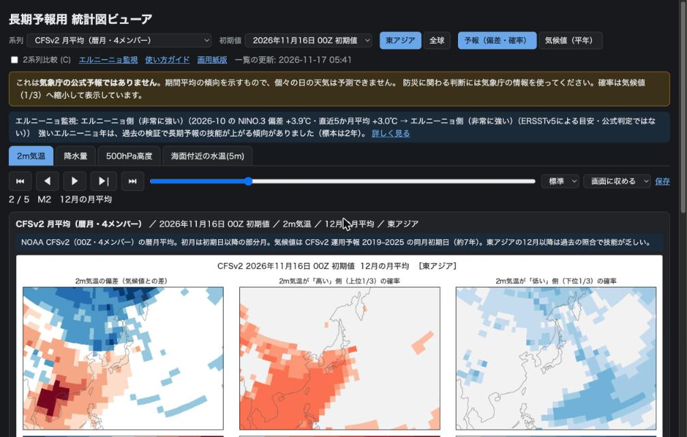
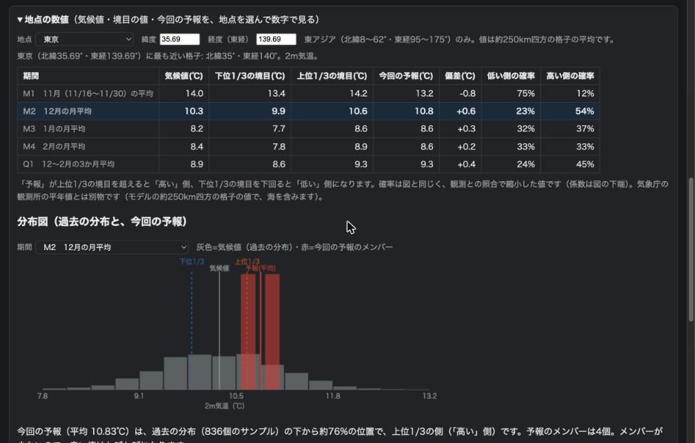
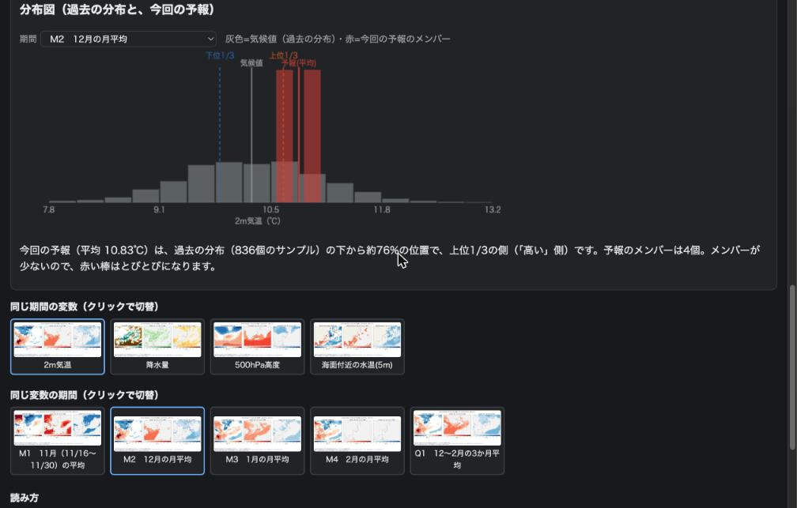

# 操作マニュアル（画面の使い方）

このサイトの画面の**操作方法**をまとめた文書です。図の意味や数字の作り方は、[使い方ガイド](guide.html)を読んでください。
画面は、パソコンでもスマホでも使えます（スマホでは、一部の表が横にスクロールします）。

> **まず試すなら**: 「標準表示」を開いて、上の「変数」タブと、図の上の ◀ ▶ ボタンを押してみてください。それだけで、変数と期間が切り替わります。

---

## 1　画面の種類

| 画面 | 何ができるか | どこから開くか |
|---|---|---|
| **標準表示** | 図を1枚ずつ（または2枚並べて）見る。地点の数値・分布図もここ | 最初に開く画面（`index.html`） |
| **画用紙版** | 変数×期間の図を、一度に並べて見る | 標準表示の上の「画用紙版」 |
| **エルニーニョ監視** | エルニーニョの現状と、半年先までの予測 | 標準表示の上の「エルニーニョ監視」 |
| **使い方ガイド** | 図の読み方・データ・統計の作り方・精度の説明（初心者向け） | 上の「使い方ガイド」 |
| **操作マニュアル** | この文書 | 上の「操作マニュアル」 |

---

## 2　標準表示の使い方

### 2-1　画面の構成（上から順に）

1. **系列**: どのモデル・どの平均かを選びます（CFSv2 週平均 / ラグ18メンバー / 月平均 / JMA CPS4）。
2. **初期値**: 計算を始めた日です。新しい順に並びます。
3. **領域ボタン**: 「東アジア」と「全球」。
4. **表示ボタン**: 「**予報（偏差・確率）**」と「**気候値（平年）**」を切り替えます（3章）。
5. **2系列比較**: チェックを入れると、右にもう1つの図を並べます（5章）。
6. **エルニーニョ監視の1行**: 現在の状態の目安。「詳しく見る」でエルニーニョ監視のページへ。
7. **変数タブ**: 2m気温・降水量・500hPa高度・海面水温に加え、**流線関数（850・200hPa）・速度ポテンシャル（200hPa）・OLR**（月平均の系列のみ。週平均の系列にはありません）。系列によって、出るタブが違います。
8. **期間の操作**: ⏮ ◀ ▶（再生） ▶| ⏭、スライダー、再生の速さ、画像の大きさ、「保存」（画像をダウンロード）。
9. **図**: 3つの地図（偏差・高い側の確率・低い側の確率）。
10. **地点の数値**（折りたたみ）: 4章。
11. **同じ期間の変数／同じ変数の期間**: 小さい図の一覧。クリックで切り替わります。

### 2-2　基本の操作

| やりたいこと | 操作 |
|---|---|
| 変数を変える | 変数タブをクリック、またはキーの ↑ ↓ |
| 期間を変える | ◀ ▶ ボタン、スライダー、またはキーの ← → |
| 期間を自動で順に見る | ▶（再生）ボタン、またはスペースキー。速さは「遅い／標準／速い」 |
| 領域を変える | 「東アジア」「全球」ボタン、またはキーの R |
| 古い（新しい）初期値の図を見る | 「初期値」の選択、またはキーの `[`（古い）と `]`（新しい） |
| 図を大きく／小さく | 「画面に収める／幅いっぱい／80%」 |
| 図をファイルに保存 | 図の上の「保存」 |

> **ヒント**: `[` `]` で初期値を前後に動かすと、「予報が変わったか（傾向が安定しているか）」を、すばやく確かめられます。

### 2-3　キーボード操作の一覧

| キー | 動作 |
|---|---|
| ← → | 期間を前・後へ |
| ↑ ↓ | 変数を前・後へ |
| `[` / `]` | 初期値を古い・新しい方へ |
| R | 領域（東アジア／全球）を切り替え |
| C | 2系列比較のオン・オフ |
| スペース | 再生・停止 |
| Home / End | 最初・最後の期間へ |

---

## 3　「気候値（平年）」の図を見る

1. 上の**表示ボタン**で「気候値（平年）」を押します。
2. 図が、次の**4枚組**に変わります。

| 枚 | 見えるもの |
|---|---|
| 1枚目 | **気候値（平年）**。過去の同じ時期の平均 |
| 2枚目 | **下位1/3の境目**（平年との差）。これより下なら「低い」側 |
| 3枚目 | **上位1/3の境目**（平年との差）。これより上なら「高い」側 |
| 4枚目 | **境目の幅**。年々のばらつきの目安 |

- 変数・期間・領域・初期値は、予報の図と**同じ操作**で切り替えられます。
- **最新の初期日だけ**、気候値の図があります。古い初期日では、「気候値の図はありません」と出ます。
- 予報の図に戻すには、「予報（偏差・確率）」を押します。

---

## 4　「地点の数値」の使い方

地図の色では読み取りにくい**具体的な数字**を、地点を選んで見られます。

### 4-1　開き方と地点の選び方

1. 図の下の「**地点の数値**」をクリックして開きます（▼が付きます）。
2. **地点**の選択で、都市を選びます（札幌・東京・大阪・福岡・那覇・ソウル・北京・上海・台北…）。
3. **都市にない場所**は、「（緯度・経度を指定）」を選ぶか、**緯度**と**経度（東経）**の欄に数字を入れます（例: 緯度 35.7・経度 139.7）。
   - **範囲**は、東アジア（北緯8〜62°・東経95〜175°）です。範囲外では「範囲外です」と出ます。
   - 西経は使えません。**東経**で入れてください。

### 4-2　表の見方

| 列 | 意味 |
|---|---|
| 期間 | 平均した期間。**いま図に出ている期間は、青くハイライト**されます |
| 気候値 | 過去の同じ時期の平均（平年） |
| 下位1/3の境目 | これを下回ると「低い」側 |
| 上位1/3の境目 | これを上回ると「高い」側 |
| 今回の予報 | 予報メンバーの平均 |
| 偏差 | 今回の予報 − 気候値 |
| 低い側の確率／高い側の確率 | 図と同じ（観測との照合で控えめにした値） |

**読み方の例**（東京付近・12月の月平均気温）: 気候値 10.3℃、上位1/3の境目 10.6℃、今回の予報 10.8℃。
→ 予報が境目（10.6℃）を超えているので「高い」側で、確率は54%。

### 4-3　注意

- 値は、**約250km四方の格子の平均**（海を含む）です。**気象庁の観測所の平年値とは別物**です。
- 変数は、**いま選んでいる変数**（上のタブ）の値です。変数を変えると、表も変わります。
- 流線関数・速度ポテンシャル・OLR は、確率が**未補正**です（表の下に注記が出ます）。
- 「ラグ18メンバー」の系列では、地点の数値は出ません。「**CFSv2 週平均（4メンバー）**」など、他の系列を選んでください。
- 気候値の図と同じく、**最新の初期日だけ**表示されます。

---

## 5　「分布図」の使い方

「地点の数値」の下に出ます。**過去の分布と、今回の予報が、どれくらい離れているか**を、目で確かめられます。

### 5-1　見方

- **灰色の棒**: 過去の分布（気候値）。棒が高いほど、その値がよく出た。
- **赤い棒**: 今回の予報のメンバー。
- **青の点線**: 下位1/3の境目。**橙の点線**: 上位1/3の境目。
- **灰色の線**: 気候値（平均）。**赤の太線**: 予報の平均。
- 下の文: 「予報の平均が、過去の分布の下から何%の位置か」。**約67%を超えると「高い」側、33%を下回ると「低い」側**です。

> **確率の意味が分かります**: 橙の点線より**右にある赤い棒の割合**が、「高い側の確率」です。

### 5-2　操作

- **期間**の選択で、別の期間の分布を見られます。
  - 初めは、図に出ている期間に自動で合います。
  - 自分で選ぶと、その選択が保たれます（変数や系列を変えると、また自動に戻ります）。
- 地点は、「地点の数値」で選んだものと同じです。

### 5-3　注意

- メンバーが少ない系列（CFSv2 は4つ）では、赤い棒が**とびとび**になります。
- 予報（平均）の線が、灰色の分布から**大きく外れている**ときは、平年から大きくずれた予報です。

---

## 6　2系列を並べて比べる

1. 上の「**2系列比較（C）**」にチェックを入れる（またはキーの C）。
2. 右に、もう1つの図が出ます。右の**系列・初期値**を、右の行で選びます（初めは CFS と CPS4 の組み合わせ）。
3. **「期間・変数・領域を左に合わせる」**にチェックがあると、左の操作に右が**自動でついてきます**。
   - 期間は、「表示される月の範囲が同じもの」に合わせます（例: CFSv2 の月2と CPS4 の L2 は、どちらも12月）。
4. 同じ時期を2つのモデルで比べて、**傾向が一致しているか**を確かめます。

---

## 7　画用紙版の使い方

- 変数（行）×期間（列）の図を、**一度に並べて**見られます。全体の傾向をつかむのに向きます。
- 上の **系列・初期値・領域・表示（予報／気候値）** を選びます。**大きさ**のスライダーで、図の大きさを変えます。
- **図をクリック**すると、その図を標準表示で開きます（系列・初期値・変数・期間・領域が引き継がれます）。

---

## 8　エルニーニョ監視ページの使い方

- 上から: **現在の状態**（観測からの目安）→ **観測の推移**（NINO.3 と NINO.3.4 の棒グラフ）→ **予測**（CPS4）→ **読み方**。
- **基準日**の選択で、過去の基準日の予測を見られます。
- 表の列: 月・平均偏差・10〜90%の範囲・エルニーニョ側／ラニーニャ側のメンバーの割合・過去28年の予測技能（ACC）。
- **NINO.3 は気象庁の指標、NINO.3.4 は NOAA の従来の ONI 方式**です。**RONI**（NOAA が2026年2月から公式に使う指標）は、観測の図の下の段に青の破線で重ねています。
- 観測と予測の図は、**気象庁の図ではなく、このサイトが NOAA・CPS4 のデータから計算したもの**です。「この図の作り方」の欄（折りたたみ）に、作り方の説明があります。数値は、気象庁の公式値と最大0.5℃ほど違うことがあります。
- 公式な判断は、気象庁の「エルニーニョ監視速報」（毎月10日ごろ発表）を見てください。

---

## 9　リンクで同じ図を共有する（URL）

画面の状態は、アドレスの `#` 以降に自動で保存されます。**アドレスをコピーして送ると、同じ図が開きます**。ブックマークにも使えます。

| 項目 | 意味 | 値の例 |
|---|---|---|
| `s` | 系列 | `cfs_week`（週平均）・`cfs_week_lag`（ラグ）・`cfs_month`（月平均）・`cps4` |
| `i` | 初期値 | `20261116` |
| `v` | 変数 | `t2m`（気温）・`prate`（降水）・`z500`・`sst`・`pot5` |
| `p` | 期間 | `W1`〜`W4`・`M1`〜`M4`・`Q1`・`L1`〜 |
| `r` | 領域 | `asia`・`global` |
| `m` | 表示 | `clim`（気候値）。無ければ予報 |
| `c` | 2系列比較 | `1`（オン）。右は `s2`・`i2`・`v2`・`p2`・`r2` |

例: 東アジアの12月の気温の気候値 → `index.html#s=cfs_month&v=t2m&p=M2&r=asia&m=clim`

---

## 10　困ったとき

| 症状 | 対処 |
|---|---|
| 図が出ない（「画像を読み込めませんでした」） | ページを再読み込み（Ctrl+R / ⌘+R）。しばらく待ってからもう一度 |
| 「この組み合わせの図はありません」 | その系列・初期値に、選んだ変数・期間の図がありません。別の変数・期間を選ぶ |
| 「気候値の図はありません」 | 気候値の図は**最新の初期日だけ**です。初期値を最新に |
| 地点の数値が出ない | ①「地点の数値」を開いているか ②ラグ18メンバー版ではないか ③最新の初期日か、を確認 |
| 「範囲外」と出る | 東アジア（北緯8〜62°・東経95〜175°）の地点を指定 |
| 初期値が古い | 更新は毎週金曜 10:00（CFS）と毎月15日（CPS4）。一覧の更新時刻が画面の上に出ています |
| キーが効かない | 入力欄や選択欄にカーソルがあると、一部のキーが効きません。画面の余白をクリックしてから押す |

---

## 11　自分のパソコンで動かすとき（上級者向け）

1. プロジェクトのフォルダで `python make_web.py`（図の一覧 `web/manifest.json` と、各ガイドのページを作る）。
2. 同じフォルダで `python -m http.server 8793 --bind 127.0.0.1` を実行し、ブラウザで `http://127.0.0.1:8793/web/` を開く。
3. ローカルの画面では、エルニーニョ監視のページに**気象庁の公式の見通し**（ローカルのみ）も出ます。公開サイトには載りません。
4. 詳しい運用（自動実行・校正・公開）は [long-range-charts.md](https://github.com/masauehr/long_range_charts/blob/main/long-range-charts.md) を参照。
